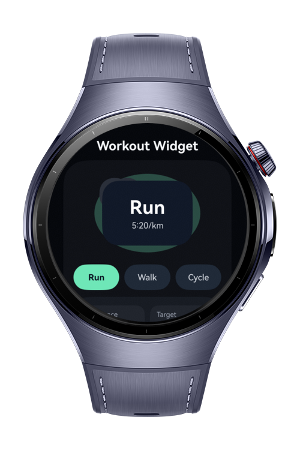
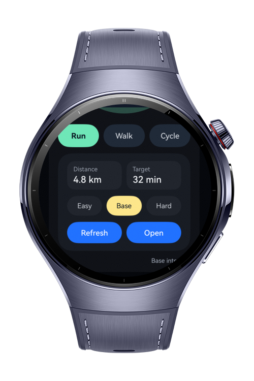
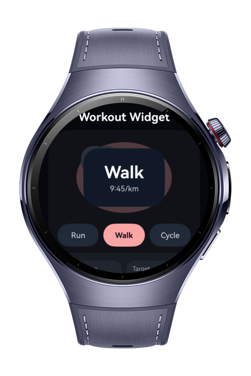
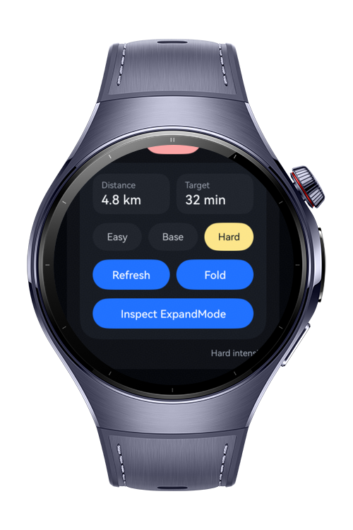

> **Note:** To access all shared projects, get information about environment setup, and view other guides, please visit [Explore-In-HMOS-Wearable Index](https://github.com/Explore-In-HMOS-Wearable/hmos-index).

# How to Build Shape Segment Button

This codelab builds a wearable workout mode selector widget for round watch screens. It combines ArkUI shape primitives with segment controls to preview a custom home-screen widget card, switch workout modes, open compact settings, and expose a form menu action.

# Preview

<div>
  
  
  
  
</div>

# Use Cases

- Clip the main widget card to the round watch display with `EllipseShape`.
- Use `PathShape` to create a custom bezier workout preview mask.
- Use `RectShape` for rounded metric cards and settings backgrounds.
- Attach form-style context menu actions through the `FormMenu` module and `AddFormMenuItem`.
- Configure typed expanded menu actions with `ExpandedMenuOptions`.
- Toggle a compact settings panel and inspect child expansion behavior with `ExpandMode`.
- Build a V2 multi-option capsule selector with `MultiCapsuleSegmentButtonV2`.
- Define legacy capsule items with `SegmentButtonItemOptionsArray` for the intensity selector.

# Technology 
## Stack

- **Languages**: ArkTS, ArkUI
- **Frameworks**: HarmonyOS SDK 6.0.1(21)
- **Tools**: DevEco Studio 6.0.1, Hvigor
- **Libraries**:
    - `@kit.ArkUI`
    - `@kit.AbilityKit`

## Module Coverage

- `EllipseShape`: Clips the outer widget card and oval workout glow to match a round wearable surface.
- `PathShape`: Clips the central preview into a custom bezier silhouette.
- `RectShape`: Creates rounded metric tiles and the expandable settings panel.
- `FormMenu`: Used as the advanced ArkUI form menu module namespace; the SDK exposes its callable builder through `AddFormMenuItem`.
- `AddFormMenuItem`: Adds the "Add widget" menu item for publishing the card snapshot source.
- `ExpandMode`: Passed to `FrameNode.getChild(0, expandMode)` when inspecting the settings panel.
- `ExpandedMenuOptions`: Stores the expanded menu actions that the wearable UI and context menu both execute.
- `MultiCapsuleSegmentButtonV2`: Drives the Run/Walk/Cycle mode selector.
- `SegmentButtonItemOptionsArray`: Defines the legacy Easy/Base/Hard capsule item array and demonstrates the API 12 item tuple factory.

# Directory Structure

```text
entry/src/main/ets/
├─ entryability
|   ├─ EntryAbility.ets
├─ pages
    ├─ Index.ets
    ├─ AdvancedModuleShowcase.ets

```

# Constraints and Restrictions

## Supported Device

* Huawei Watch 5
* HarmonyOS wearable emulator

# License

**How to Build Shape Segment Button** is distributed under the terms of the MIT License. See the [LICENSE](LICENSE) for more information
